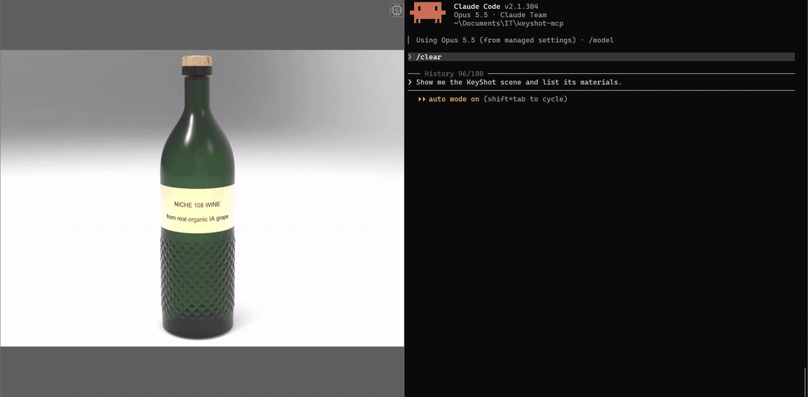

# keyshot-mcp

<!-- mcp-name: io.github.lfoletti/keyshot-mcp -->

Control an open KeyShot Studio 2026 window from Claude Code with the Model Context Protocol (MCP).

[](LICENSE)
[](#status)
[](https://github.com/lfoletti/keyshot-mcp/actions/workflows/tests.yml)
[](https://github.com/lfoletti/keyshot-mcp/releases)

> **Status: prototype.** The tools work and have tests, but the project depends on the scripting API of KeyShot, which can change. Tell us what you use and what fails: open an issue or a discussion.



*The demo plays 3 times faster than real time.*

```
Claude Code ⇄ MCP server keyshotmcp (Python 3.12, stdio)
            ⇄ TCP 127.0.0.1:1998, 4-byte length + JSON, token
            ⇄ MCP start.py (in KeyShot, timer on the UI thread)
```

The bridge runs inside KeyShot. The server runs in Claude Code. They speak only on the local computer.

## Requirements

| Item | Version |
|---|---|
| KeyShot Studio | 15.1 (2026) or later. Tested with 2026.2 Pro (15.1.2.7). |
| Python | 3.12 or later, Windows |
| `mcp` | 1.28.1 |
| Claude Code | any recent version |

## Install

### From PyPI

From version 1.1.0, `keyshot-mcp` is a Python package. With [uv](https://docs.astral.sh/uv/):

```
uvx keyshot-mcp install-addin
claude mcp add keyshot -- uvx keyshot-mcp
```

`install-addin` copies the two bridge scripts into `%PUBLIC%\Documents\KeyShot Studio\Scripts` (or the folder of `--dir`). Then restart KeyShot.

### As a Claude Code plugin

From version 1.1.0, this repository is also a Claude Code marketplace. The plugin `keyshot` starts the server with `uvx`, so [uv](https://docs.astral.sh/uv/) must be installed.

```
/plugin marketplace add lfoletti/keyshot-mcp
/plugin install keyshot@keyshot-mcp
```

Then run `/keyshot-install-addin` once, and restart KeyShot.

### From the release zip or the repository

Each release has `keyshot-mcp-<version>-windows.zip`, with `libs/` already filled. Unzip it, then go to step 3. Without the zip, start at step 1.

1. Clone the repository:
   ```
   git clone https://github.com/lfoletti/keyshot-mcp.git
   ```
2. Install `mcp` in the `libs` folder. `run.py` loads it from there.
   ```
   py -3.12 -m pip install --target libs mcp==1.28.1
   ```
3. Copy `addin\Scripts\MCP start.py` and `MCP stop.py` to
   `C:\Users\Public\Documents\KeyShot Studio\Scripts\`.
4. Restart KeyShot. KeyShot reads the Scripts folder only when it starts.
5. Add the server to Claude Code:
   ```
   claude mcp add keyshot -- py -3.12 -I -S C:\path\to\keyshot-mcp\run.py
   ```
6. Make sure the imports are correct:
   ```
   py -3.12 -I -S run.py --check
   ```
   The output shows `keyshot : imports ok` and 33 tools.

## Use

1. In KeyShot, open *Window > Scripting Console > Scripts*.
2. Select `MCP start`, then click *Run*. The console shows `Pont KeyShot actif sur 127.0.0.1:1998`.
3. In Claude Code, type `/mcp`. Make sure that `keyshot` is connected.
4. Ask Claude, for example:
   - "Show me the scene and list the materials."
   - "Apply brushed aluminium to the cap, then make a 1920 × 1080 render."

To stop the bridge, run the script `MCP stop`, or close KeyShot.
To update the bridge, copy the new file, then use the tool `reload_bridge`.

## Tools

| Group | Tools |
|---|---|
| Scene | `keyshot_status`, `get_scene_info`, `get_scene_tree`, `list_objects`, `set_visibility`, `screenshot`, `save_scene` |
| Cameras and environment | `list_cameras`, `set_camera`, `fit_camera`, `list_environments`, `set_environment`, `set_realtime` |
| Materials | `list_materials`, `get_material`, `list_library_materials`, `assign_material`, `set_material_parameter`, `rename_material`, `undo_material_changes`, `commit_material_changes`, `save_material_to_library` |
| Material graph | `add_material_node`, `connect_material_nodes`, `disconnect_material_input`, `remove_material_node` |
| Render | `render_image`, `render_status`, `wait_for_render`, `view_image` |
| Bridge | `lux_functions`, `reload_bridge`, `execute_python` (off by default) |

Two MCP prompts give Claude the method:

| Prompt | Use |
|---|---|
| `keyshot_strategy` | How to work in KeyShot without damage to the scene. |
| `keyshot_materiaux` | How to make materials from a CMF sheet (color, material, finish) or a description: physical values, colors, node recipes. |

Colors: `[r, g, b]` is linear (0-1). `#RRGGBB` is sRGB: the bridge changes it to linear.

## Settings

Optional file: `%LOCALAPPDATA%\keyshot-mcp\pont-config.json`.

```json
{"execute_python": false, "dossier_sorties": "C:\\path\\to\\outputs"}
```

| Setting | Effect |
|---|---|
| `execute_python` | `true` enables the tool `execute_python`. The default is `false`. |
| `dossier_sorties` | Folder for screenshots, renders and scene backups. |
| `dossiers_textures` | List of more folders where the bridge can read texture images. KeyShot's texture library and `dossier_sorties` are always allowed. |
| `KEYSHOT_MCP_PORT` | Environment variable. Bridge port. The default is 1998. |
| `KEYSHOT_MCP_TIMEOUT` | Environment variable. Server timeout in seconds. The default is 60. |
| `KEYSHOT_MCP_EXECUTE_PYTHON` | Environment variable. `1` enables `execute_python`. |

The bridge writes `pont-actif.json` (port, token, KeyShot PID) and `pont.log` in the same folder.

## Safety

- The bridge listens only on 127.0.0.1. Each request must have the token from `pont-actif.json`.
- `execute_python` is off. Only a local setting can enable it.
- The tools edit a material graph only on copies that the bridge made.
- `set_camera` does not discard a camera view that is not saved.
- `save_scene` keeps a copy of the old `.bip` file.

## Tests

The tests use a fake `lux` module. KeyShot is not necessary.

```
cd tests
py -3.13 test_pont.py
py -3.13 test_serveur_mcp.py
```

`test_pont.py` has 85 tests for the bridge. `test_serveur_mcp.py` has 9 end-to-end tests. The `essai_*.py` files need an open KeyShot.

`test_serveur_mcp.py` starts the server with the Python that runs the test. If the packages in `libs` are for a different Python version, set `KEYSHOT_MCP_PYTHON` to the applicable `python.exe`.

## Contribute

Read [CONTRIBUTING.md](CONTRIBUTING.md) and [CODE_OF_CONDUCT.md](CODE_OF_CONDUCT.md).

## Status

keyshot-mcp is a working prototype. It is tested with KeyShot Studio 2026.2 Pro on Windows.

- The bridge uses the KeyShot scripting API (`lux`). A new KeyShot version can change this API.
- KeyShot can add its own integration with Claude in a future version. This project can then stop.
- Feedback has priority over new features. Use the issue templates *Bug* and *Feedback*.

## Disclaimer

keyshot-mcp is an independent project. It is not affiliated with Luxion or KeyShot, and so far Luxion does not endorse or sponsor it. KeyShot is a trademark of Luxion.

## License

MIT
